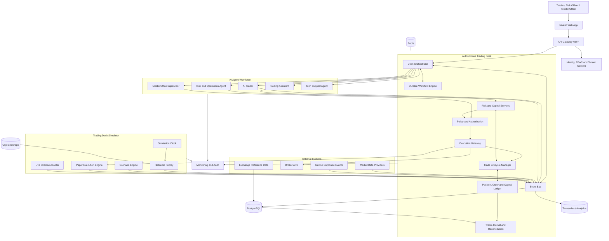
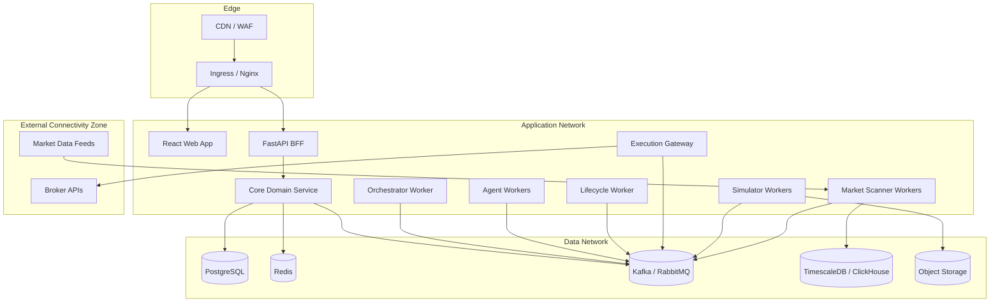
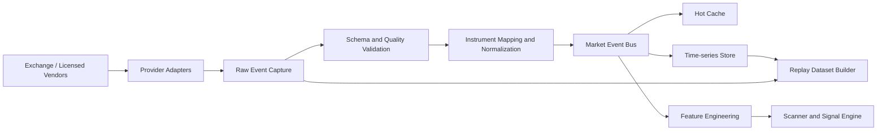
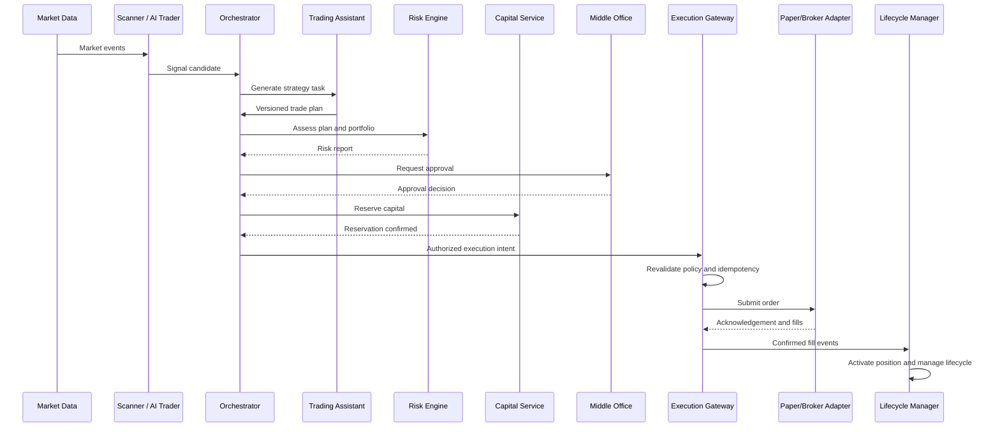
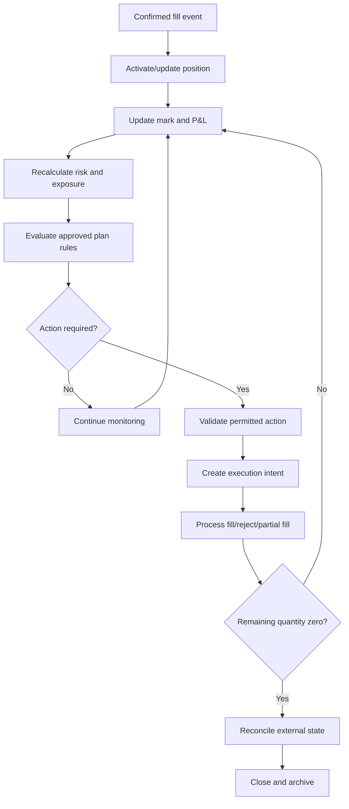
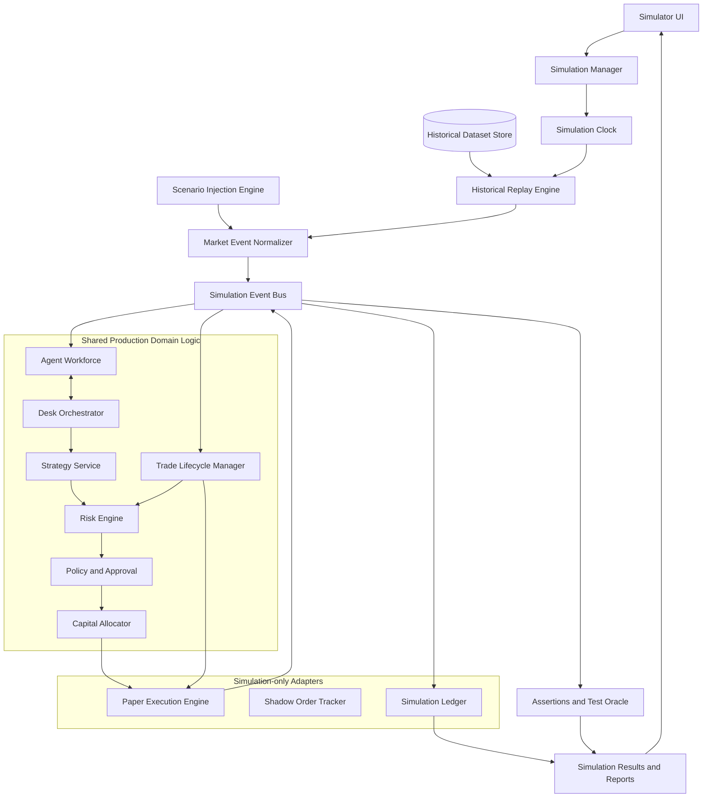
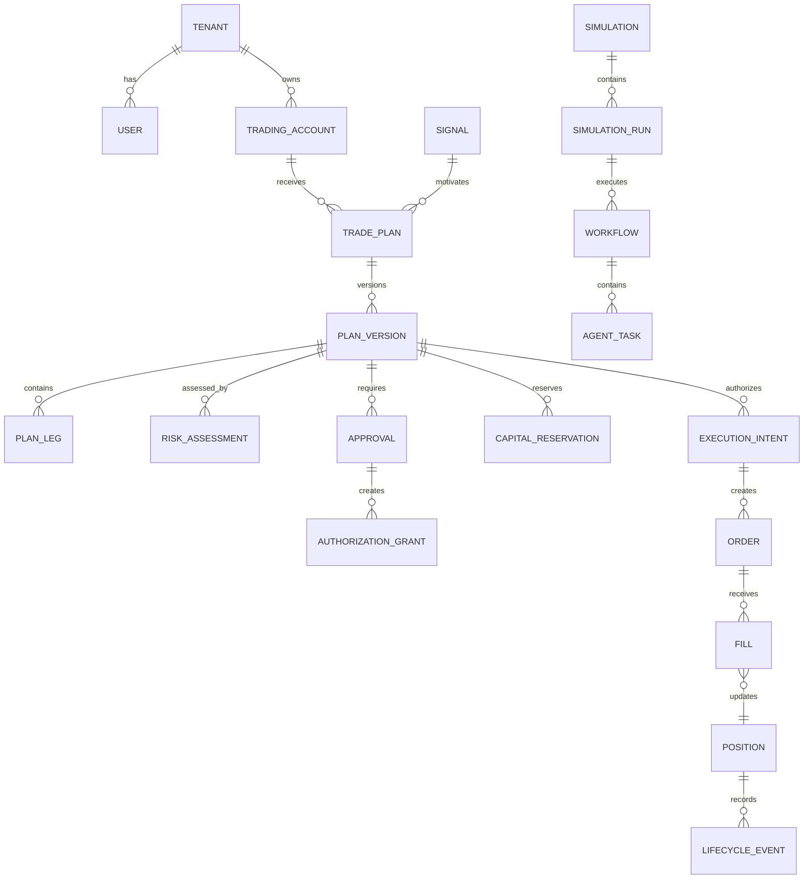

# Nivesh.ai Autonomous Trading Desk
## Technical Architecture and System Design

**Document version:** 1.0  
**Date:** 5 November 2026  
**Companion PRD:** Nivesh Autonomous Trading Desk Complete PRD v2.0  
**Status:** Proposed target architecture  
**Primary market:** India — NSE/BSE cash, futures and options

---

# 1. Architecture Summary

## 1.1 Architectural objective

Build an event-driven, multi-agent trading platform that can operate a complete trading lifecycle while enforcing strict separation between:

1. AI reasoning and recommendations.
2. Deterministic financial calculations and policy enforcement.
3. Trade authorization.
4. Order execution.
5. Position lifecycle management.
6. Simulation and certification.
7. Audit, reconciliation and operational supervision.

The system must support research, assisted trading, autonomous paper trading, live shadow simulation and controlled autonomous live execution.

## 1.2 Core architectural principle

**Agents do not directly execute trades.**

Agents submit structured proposals and task results to deterministic services. Only the Execution Gateway can route an authorized execution intent to an execution adapter. The gateway revalidates authorization, risk, account, mode, quantity and idempotency immediately before submission.

The Trade Lifecycle Manager (TLM) owns the lifecycle of confirmed positions. It uses deterministic rules and policy-controlled actions. LLMs may explain, assess or recommend changes, but must not be a runtime dependency for protective position management.

## 1.3 Recommended technology baseline

| Layer | Recommended technology | Responsibility |
|---|---|---|
| Frontend | React 18, TypeScript, Tailwind, Shadcn/UI | Trading desk and simulator UI |
| API/BFF | Python FastAPI | User-facing and service APIs |
| Agent runtime | Python, LangGraph or controlled custom agent runtime | Agent reasoning and tool orchestration |
| Durable workflow | Temporal or equivalent | Long-running workflows, retries, timers and recovery |
| Event streaming | Kafka/Redpanda; RabbitMQ for simpler command queues | Market, order, lifecycle and agent events |
| Transactional database | PostgreSQL | System of record |
| Cache/state acceleration | Redis | Short-lived cache, locks where appropriate, rate limits |
| Time-series/analytics | TimescaleDB extension or ClickHouse | High-volume bars, ticks and analytics |
| Object storage | S3-compatible storage | Replay datasets, reports, model artefacts |
| Quantitative libraries | NumPy, Pandas, SciPy, QuantLib-Python | Analytics, risk and options calculations |
| Observability | OpenTelemetry, Prometheus, Grafana, Loki | Logs, metrics and traces |
| Secrets | Cloud Secret Manager/Vault/KMS | Broker credentials and signing keys |
| Deployment | Docker initially; Kubernetes when justified | Packaging and orchestration |

Do not adopt every component on day one. Start with a modular monolith for transactional business services, separate worker processes for agents and scanners, and a durable event/workflow layer. Split services when scaling, fault isolation or deployment cadence justifies it.

---

# 2. System Context and High-Level Architecture

## 2.1 Context diagram



## 2.2 Trust boundaries

The architecture has five trust zones:

| Zone | Components | Trust rule |
|---|---|---|
| User zone | Web app, browser, mobile | Treat all client input as untrusted |
| Agent zone | AI Trader, Trading Assistant, other agents | Agents have scoped tools and no direct broker credentials |
| Control zone | Risk, policy, capital, approval, lifecycle | Deterministic validation and authorization |
| Execution zone | Execution Gateway and adapters | Only zone permitted to submit orders |
| External zone | Brokers, market data, news providers | External data and callbacks are untrusted until validated |

The simulator is a separate execution trust boundary. Its credentials, account identifiers, event topics and database records must not be accepted by live execution adapters.

---

# 3. Logical Component Architecture

## 3.1 API Gateway and Backend-for-Frontend

Responsibilities:

- Authenticate user sessions.
- Resolve tenant and account context.
- Enforce API-level permissions.
- Apply rate limits.
- Validate request schemas.
- Route requests to domain services.
- Provide dashboard aggregation APIs.
- Expose WebSocket/SSE updates.
- Never make trading authorization decisions solely from client-supplied fields.

Suggested modules:

- Authentication API
- Desk API
- Agent API
- Signal API
- Strategy API
- Approval API
- Risk API
- Execution API
- Lifecycle API
- Simulator API
- Reporting API
- Admin API

## 3.2 Desk Orchestrator

Responsibilities:

- Start and coordinate workflows.
- Assign tasks to agents.
- Track dependencies and deadlines.
- Persist workflow state through the durable workflow engine.
- Correlate all tasks, events and decisions.
- Manage human approval waits.
- Handle retries and escalations.
- Enforce agent task permissions.
- Prevent a workflow from advancing when mandatory checks are incomplete.

The orchestrator coordinates. It does not calculate risk, approve trades or submit orders.

## 3.3 Agent Runtime

Each agent runs in a controlled runtime with:

- Agent identity and version.
- Role-specific system instructions.
- Allowed tools.
- Structured input/output schemas.
- Tenant/account-scoped context.
- Time and token budgets.
- Task deadline.
- Retry policy.
- Output validation.
- Audit trace.

Agents should be stateless between tasks where possible. Persistent business context belongs in the database and event history, not hidden model memory.

### Agent service boundaries

| Agent | Inputs | Outputs | Prohibited authority |
|---|---|---|---|
| AI Trader | Market snapshots, universe, scanner rules | Signal candidates and evidence | Cannot allocate capital or execute |
| Trading Assistant | Signal, user constraints, portfolio snapshot | Versioned trade proposal | Cannot approve own proposal or execute |
| Risk & Operations | Plan, account, positions, policies | Risk assessment and violations | Cannot weaken hard policies |
| Middle Office | Validated plan, approval policy, risk report | Approval/rejection decision | Cannot alter fills or bypass gateway |
| Tech Support | Health metrics, incident events | Incident and recovery recommendations | Cannot create trades or change risk limits |

The Risk Engine and Policy Engine remain deterministic services. An AI Risk & Operations agent can interpret reports and recommend actions, but cannot replace those services.

## 3.4 Deterministic control plane

The control plane contains:

1. Instrument Eligibility Service
2. Risk Calculation Service
3. Portfolio Exposure Service
4. Capital Allocation Service
5. Policy Evaluation Service
6. Approval Service
7. Authorization Grant Service
8. Execution Intent Validator

These services must be independently testable and must not depend on LLM availability.

## 3.5 Trade Lifecycle Manager

TLM is a persistent service with its own state machine and durable event processing.

Responsibilities:

- Activate positions from confirmed fills.
- Maintain actual filled quantity and average price.
- Evaluate stop, target and trailing rules.
- Recalculate remaining risk.
- Monitor expiry and holding period.
- Manage partial exits.
- Coordinate multi-leg position state.
- Create permitted action intents.
- Escalate conditions requiring new approval.
- Recover from restart and reconcile external state.

TLM may call the Risk Engine and Execution Gateway. It must not call broker APIs directly.

## 3.6 Execution Gateway

The gateway is the only order-submission boundary.

Responsibilities:

- Validate execution mode.
- Validate tenant/account ownership.
- Validate plan version and authorization.
- Revalidate risk and funds.
- Validate instrument, quantity, tick and lot size.
- Validate price collars and order type.
- Enforce idempotency.
- Persist intent before submission.
- Route to exactly one adapter.
- Normalize order/fill responses.
- Reconcile uncertain responses.
- Publish order and fill events.

---

# 4. Runtime Deployment Architecture

## 4.1 Initial deployment topology

Recommended initial deployment for a controlled MVP:



### Deployment principles

- Keep PostgreSQL private; no direct browser access.
- Keep broker credentials only in the secrets manager and execution adapter runtime.
- Put broker connectivity in a restricted outbound network zone.
- Separate CPU-intensive scanners and replay workers from latency-sensitive execution services.
- Use independent worker pools and resource limits.
- Do not allow simulator containers to mount live secrets.
- Deploy the execution gateway and lifecycle manager with stricter availability and change controls than the UI or LLM agents.

## 4.2 Scaling path

**MVP:** Modular FastAPI domain service, PostgreSQL, Redis, RabbitMQ, separate agent/scanner/TLM workers and isolated simulator process.

**Growth:** Add Kafka/Redpanda for high-volume market events, TimescaleDB/ClickHouse for analytics, Temporal for durable workflows, independent service deployments and horizontally scaled consumers.

**Scale:** Partition event streams by instrument/account, isolate tenants where required, deploy regionally resilient data services and use dedicated execution infrastructure with tested failover.

Avoid premature microservice proliferation. Service boundaries should follow data ownership, failure isolation and independent scaling needs.

---

# 5. Data Architecture

## 5.1 Data ownership

| Domain | Authoritative owner |
|---|---|
| User, tenant and permissions | Identity service |
| Instrument master and contract metadata | Reference data service |
| Market observations | Market data ingestion service |
| Signals | Signal service |
| Strategy proposals and versions | Strategy service |
| Policies and approvals | Policy/approval service |
| Capital reservations and ledger | Capital service |
| Orders and fills | Execution ledger, reconciled with adapter |
| Positions | Position ledger, reconciled with paper/broker |
| Lifecycle state | TLM |
| Simulation clock and scenario | Simulator |
| Agent task history | Orchestrator/agent task service |
| Audit events | Audit service |

Each domain must have a clear write owner. Other services use APIs or events rather than writing directly into another service's tables.

## 5.2 Storage pattern

### PostgreSQL

Use for:

- Tenants and users
- Accounts and broker connections metadata
- Policies and approvals
- Signals and trade plans
- Capital reservations and ledger
- Execution intents, orders and fills
- Positions and lifecycle state
- Agent tasks and workflow metadata
- Simulation metadata and results
- Audit references

Use NUMERIC/DECIMAL for financial values. Use explicit currency and quantity units.

### Time-series/analytics store

Use for:

- Tick and quote data where licensed
- OHLCV bars
- Futures and options snapshots
- Greeks and volatility observations
- Market breadth and sector data
- Replay event streams
- Aggregated performance series

TimescaleDB is a practical starting point if PostgreSQL operational simplicity is important. ClickHouse is appropriate when analytical scan volume and columnar aggregation become dominant.

### Redis

Use for:

- Short-lived market snapshots
- Session/cache data
- Rate limiting
- Ephemeral subscriptions
- Distributed coordination only where durable alternatives are not required

Do not use Redis as the source of truth for orders, fills, positions or capital.

### Object storage

Use for:

- Historical replay datasets
- Raw provider files
- Simulation exports
- Model artefacts
- Reports
- Archived event bundles

## 5.3 Market data pipeline



Every event should preserve:

- Provider and source identifier
- Exchange event timestamp
- Ingestion timestamp
- Instrument identifier and mapping version
- Schema version
- Data-quality status
- Sequence number where available

Data freshness policies are strategy-specific. A stale-data condition must block new risk-increasing actions that depend on that data.

---

# 6. Event-Driven Architecture

## 6.1 Event bus design

Use separate logical topics or queues for:

- `market.events`
- `signals.events`
- `strategy.events`
- `risk.events`
- `capital.events`
- `approval.events`
- `execution.commands`
- `execution.events`
- `lifecycle.events`
- `agent.tasks`
- `agent.results`
- `simulation.events`
- `reconciliation.events`
- `system.incidents`
- `audit.events`

Partition high-volume streams by instrument or another workload-specific key. Account-sensitive events must use appropriate access controls and topic ACLs.

## 6.2 Event envelope

```json
{
  "event_id": "EVT-uuid",
  "event_type": "ORDER_PARTIALLY_FILLED",
  "event_version": 1,
  "occurred_at": "2026-11-05T04:05:00Z",
  "published_at": "2026-11-05T04:05:00.010Z",
  "tenant_id": "TENANT-01",
  "account_id": "PAPER-001",
  "simulation_id": "SIM-001",
  "workflow_id": "WF-001",
  "correlation_id": "TRADE-001",
  "causation_id": "EVT-PARENT",
  "producer": "paper-execution-adapter",
  "payload": {}
}
```

For production live events, `simulation_id` is null and the environment/account binding must be explicit. Never infer live or paper mode from a missing field.

## 6.3 Delivery and consistency

- Assume at-least-once delivery.
- Consumers must be idempotent.
- Use transactional outbox for database-to-event publication.
- Use inbox/deduplication records for consumer processing.
- Use bounded retries and dead-letter queues.
- Preserve ordering where the domain requires it.
- Do not claim global exactly-once semantics.
- Use durable workflow state for long-running approval and lifecycle processes.

## 6.4 Commands versus events

Commands request an action and may be rejected. Events record facts that have occurred.

Examples:

- `SubmitOrder` is a command.
- `OrderAccepted` is an event.
- `RequestApproval` is a command.
- `ApprovalGranted` is an event.
- `EvaluatePosition` is a command.
- `StopConditionObserved` is an event.
- `PositionClosed` is emitted only after confirmed exit fills and reconciliation.

---

# 7. End-to-End Technical Workflows

## 7.1 Signal-to-trade workflow



If any mandatory step fails, the workflow must stop or enter a defined exception state. An AI agent must not skip a failed risk or approval step.

## 7.2 Position lifecycle event loop



The TLM is event-driven. It must not depend on an LLM call for stop/target evaluation, risk recalculation or order-state processing.

## 7.3 Plan amendment workflow

1. Agent or user proposes amendment.
2. Strategy service creates a new immutable plan version.
3. Risk Engine calculates before/after risk.
4. Policy Engine determines approval requirements.
5. Middle Office/user approves or rejects.
6. Authorization grant is bound to the new version.
7. TLM activates only the approved changes.
8. Old version remains in audit history.

Any amendment that increases maximum loss, exposure, leverage or quantity requires fresh authorization. A risk-reducing change may be pre-authorized only if explicitly covered by policy.

---

# 8. Capital, Risk and Ledger Architecture

## 8.1 Capital ledger

Maintain an append-only capital movement ledger with entries such as:

- CAPITAL_AVAILABLE
- CAPITAL_RESERVED
- CAPITAL_RESERVATION_RELEASED
- MARGIN_UTILIZED
- MARGIN_RELEASED
- REALIZED_PNL
- FEES_BOOKED
- MANUAL_ADJUSTMENT

Balances are derived from ledger entries and reconciled snapshots. Never update available capital through untraceable direct field mutation.

## 8.2 Atomic allocation

Reservation flow:

1. Receive allocation request with account, plan version and idempotency key.
2. Lock or serialise the relevant account allocation state.
3. Recalculate available funds and policy limits.
4. Check existing reservations and pending orders.
5. Create reservation in a database transaction.
6. Publish reservation event using outbox.
7. Convert reservation to deployed/margin state as fills arrive.
8. Release unused amount after order completion/cancellation is confirmed.

The reservation service must prevent two concurrent proposals from consuming the same buying power.

## 8.3 Risk calculation service

Separate calculation modules:

- Equity position risk
- Futures risk and notional exposure
- Options payoff and Greeks
- Multi-leg strategy risk
- Portfolio aggregation
- Correlation and concentration
- Margin and funds validation
- Stress scenarios
- Daily loss and drawdown
- Liquidity and execution risk

Every calculation result stores:

- Input snapshot reference
- Calculation timestamp
- Formula/library version
- Assumptions
- Output values
- Warnings and missing data
- Policy version used

Risk calculations must be reproducible for audit and simulation.

## 8.4 Financial precision

- Use decimal arithmetic for money, prices and ledger quantities.
- Use explicit rounding rules per exchange instrument.
- Store lot size and tick size with instrument master version.
- Avoid binary float for ledger posting.
- Quantitative libraries may use floating-point arrays internally, but financial posting must convert through controlled decimal rounding and validation.

---

# 9. Execution Architecture

## 9.1 Execution boundary

All order routes pass through:

`Trade Workflow → Execution Intent → Execution Gateway → Mode Router → Adapter → External Execution System`

The mode router selects exactly one adapter based on server-side account configuration:

- Paper adapter
- Broker adapter
- Shadow adapter (no order submission)

Client input must never choose the adapter directly.

## 9.2 Adapter contract

```python
from typing import Protocol

class ExecutionAdapter(Protocol):
    async def place_order(self, order, idempotency_key: str): ...
    async def modify_order(self, order_id: str, changes, idempotency_key: str): ...
    async def cancel_order(self, order_id: str, idempotency_key: str): ...
    async def get_order_status(self, order_id: str): ...
    async def get_positions(self, account_id: str): ...
    async def get_funds(self, account_id: str): ...
    async def get_fills(self, order_id: str): ...
    async def get_margin(self, account_id: str): ...
    async def health_check(self): ...
```

Broker adapters must normalize broker-specific semantics without pretending every broker supports identical order types or callback behaviour.

## 9.3 Submission safety

Before submission, gateway checks:

- Authenticated principal and tenant
- Account ownership and account status
- Environment and execution mode
- Exact plan version
- Approval grant validity and scope
- Policy version and current policy
- Risk and capital reservation
- Instrument eligibility
- Quantity, lot size and tick size
- Price collar and allowed order type
- Remaining position/order quantity
- Idempotency key
- Market session and broker capability
- Kill-switch and incident state

Persist execution intent before calling the adapter. If response is unknown, query/reconcile external state before retrying.

## 9.4 Protective order handling

Where broker capabilities permit, protective orders should be placed and verified at the broker. The system must track whether protection is:

- Not required by strategy
- Pending submission
- Acknowledged
- Active
- Partially filled
- Rejected
- Cancelled
- Unknown/reconciliation required

Do not assume an internal stop trigger is equivalent to an exchange/broker-side stop order. Clearly distinguish synthetic stops from broker-hosted protective orders and document their outage/gap risks.

---

# 10. Trading Desk Simulator Architecture

## 10.1 Design principle

The simulator should reuse the same domain contracts and business rules as the production desk while replacing live external dependencies with isolated simulated adapters.

Shared components:

- Strategy service
- Risk calculation service
- Capital allocation logic
- Policy evaluation logic
- Approval workflow
- Trade Lifecycle Manager
- Trade journal
- Agent task contracts
- Event schemas

Simulation-specific components:

- Simulation Manager
- Simulation Clock
- Historical Replay Engine
- Scenario Injection Engine
- Market Event Adapter
- Paper Execution Engine
- Simulation Ledger namespace
- Simulation Assertions and Results

The simulator must not fork business logic into a separate implementation. Configuration and adapters should vary; the core domain rules should remain shared.

## 10.2 Simulator architecture diagram



## 10.3 Simulation modes

### Historical replay

- Read point-in-time historical events.
- Preserve original event chronology.
- Enforce no future-data leakage.
- Reconstruct market state from available records.
- Replay order and lifecycle logic against the historical stream.

### Accelerated replay

- Support configurable playback speed.
- Support pause, resume, event-step and workflow-step.
- Preserve event sequence and causal ordering.
- Checkpoint progress for recovery.

### Scenario simulation

Inject controlled events such as:

- Gap up/down
- Volatility spike/crush
- Liquidity deterioration
- Price gap through stop
- Partial fill and rejection
- Broker disconnect
- Stale data
- Duplicate callback
- Agent timeout
- Queue backlog
- Multi-leg execution imbalance
- Margin increase
- Risk limit breach

### Live shadow

- Consume live market data.
- Run the real agent and risk workflow.
- Create hypothetical orders and positions.
- Never route an order to a broker.
- Compare hypothetical decisions with subsequent market data.
- Use a separate account namespace and execution adapter.

## 10.4 Simulation isolation

Use separate:

- Database schema or database for simulation records.
- Event topics and credentials.
- Service identity and runtime configuration.
- Object-storage prefix/bucket.
- Account IDs and ledger namespace.
- Execution adapter allowlist.
- Secrets and network policy.

The live broker adapter must reject any request carrying a simulation identifier or simulation service identity. The simulator must have no access to live broker credentials.

## 10.5 Simulation clock

The simulation clock is authoritative for replay event time. Store both simulation time and wall-clock processing time.

Clock controls:

- Start, pause, resume and stop
- Playback speed
- Step one event
- Step one workflow
- Seek to checkpoint
- Deterministic random seed
- Session calendar and holidays

Agents must receive only data available at the simulation time. Feature generation and signal evaluation must use point-in-time data snapshots.

## 10.6 Market and fill realism

Execution simulation must model, where data permits:

- Bid/ask spread
- Available depth
- Volume constraints
- Partial fills
- Queue assumptions
- Latency
- Slippage
- Rejections
- Order modifications and cancellation
- Price bands and trading halts
- Brokerage, statutory charges and fees
- Margin and expiry behaviour

If only OHLCV is available, disclose that exact intrabar order of stop/target touches and queue-level fills cannot be known. Use conservative assumptions and report them.

## 10.7 Simulation result metrics

- Net and gross P&L
- Maximum drawdown
- Open and peak risk
- Margin utilisation
- Slippage and charges
- Fill ratio
- Rejection rate
- Strategy expectancy
- MAE/MFE
- Signal coverage and precision
- Agent task completion and latency
- Handoff/rework/escalation rates
- Policy violations
- Recovery success
- Reconciliation differences

Simulation reports must state data coverage, execution model, costs, assumptions, model/prompt/policy versions and limitations.

---

# 11. Agent Coordination and Workflow Architecture

## 11.1 Durable task lifecycle

`CREATED → ASSIGNED → ACCEPTED → RUNNING → RESULT_READY → VALIDATED → COMPLETED`

Exception states: REJECTED, BLOCKED, TIMED_OUT, RETRY_PENDING, FAILED, ESCALATED, CANCELLED.

Each task stores:

- Task ID and simulation ID if applicable
- Workflow and correlation IDs
- Tenant/account context
- Requesting and receiving agent
- Task type
- Input references
- Output schema/version
- Deadline and retry policy
- Tool permissions
- Result reference
- Validation result
- Model/prompt/agent version
- Start/completion timestamps

## 11.2 Agent message contract

```json
{
  "task_id": "TASK-5001",
  "workflow_id": "WF-1001",
  "simulation_id": "SIM-001",
  "from_agent": "AI_TRADER",
  "to_agent": "TRADING_ASSISTANT",
  "task_type": "GENERATE_STRATEGY",
  "entity_id": "SIGNAL-1001",
  "input_refs": ["signal://SIGNAL-1001"],
  "constraints": {
    "execution_mode": "PAPER",
    "max_capital": "150000.00",
    "max_risk": "4000.00"
  },
  "deadline": "2026-11-05T09:32:00+05:30",
  "required_output_schema": "trade-plan-v1"
}
```

Use references to canonical records rather than copying large or sensitive payloads into every agent message.

## 11.3 Handoff protocol

1. Orchestrator creates task.
2. Task is persisted before dispatch.
3. Receiving agent acknowledges.
4. Agent loads authorized context.
5. Agent executes allowed tools.
6. Agent returns structured result.
7. Schema validator validates output.
8. Domain service validates business rules.
9. Orchestrator records handoff and schedules next task.
10. Timeout or invalid result triggers bounded retry or escalation.

## 11.4 Disagreement protocol

- Agents may challenge recommendations with evidence and structured reasons.
- Trading Assistant may revise a proposal.
- Risk Engine has final authority on deterministic risk constraints.
- Policy Engine has final authority on hard policy.
- Middle Office/user provides required authorization.
- Orchestrator cannot resolve a hard-policy conflict by voting.
- If disagreement cannot be resolved within the workflow deadline, no trade is submitted.

## 11.5 LLM resilience

- Agent tasks have deadlines and token budgets.
- Use structured output and schema validation.
- Keep prompts and model versions immutable per task.
- Use deterministic fallbacks only where explicitly designed.
- LLM outage blocks new AI-dependent proposals, not existing deterministic lifecycle management.
- Do not place LLM calls on the critical stop/exit execution path.

---

# 12. API and Service Contracts

## 12.1 API design

Use REST for user-facing commands and queries. Use WebSocket or Server-Sent Events for live dashboard updates. Use event bus contracts for internal asynchronous communication.

Common API requirements:

- `/api/v1` versioning
- OpenAPI schemas
- OAuth/OIDC or secure session authentication
- Tenant and account scope
- Idempotency keys for mutations
- Correlation IDs
- Pagination and filtering
- Rate limits
- Consistent error envelope
- Audit event for sensitive operations

## 12.2 Core service APIs

| Service | Example endpoint | Purpose |
|---|---|---|
| Desk | `GET /api/v1/desk/status` | Desk status |
| Workflow | `POST /api/v1/workflows` | Start workflow |
| Agent | `POST /api/v1/agents/{id}/tasks` | Assign task |
| Signals | `GET /api/v1/signals` | Search signals |
| Strategy | `POST /api/v1/strategies/generate` | Generate proposal |
| Trade Plan | `POST /api/v1/trade-plans` | Create plan |
| Risk | `POST /api/v1/risk/assessments` | Assess plan |
| Capital | `POST /api/v1/capital/reservations` | Reserve funds |
| Approval | `POST /api/v1/approvals` | Request approval |
| Execution | `POST /api/v1/execution/intents` | Submit authorized intent |
| Lifecycle | `GET /api/v1/lifecycle/{trade_id}` | Get lifecycle |
| Reconciliation | `POST /api/v1/reconciliation/run` | Reconcile |
| Simulator | `POST /api/v1/simulations` | Create simulation |
| Simulator | `POST /api/v1/simulations/{id}/start` | Start run |
| Simulator | `POST /api/v1/simulations/{id}/pause` | Pause |
| Simulator | `POST /api/v1/simulations/{id}/scenarios` | Inject scenario |
| Simulator | `GET /api/v1/simulations/{id}/timeline` | Event timeline |
| Simulator | `GET /api/v1/simulations/{id}/results` | Results |

## 12.3 Example execution intent

```json
{
  "execution_intent_id": "EXE-1001",
  "tenant_id": "TENANT-01",
  "account_id": "PAPER-001",
  "trade_id": "TRADE-1025",
  "plan_version": 3,
  "execution_mode": "PAPER",
  "authorization_id": "AUTH-5001",
  "capital_reservation_id": "RES-2001",
  "idempotency_key": "TRADE-1025-ENTRY-V3",
  "order": {
    "instrument_id": "NSE:RELIANCE",
    "side": "BUY",
    "quantity": 10,
    "order_type": "LIMIT",
    "limit_price": "1500.00"
  }
}
```

The gateway must resolve the adapter from server-side account configuration. It must not trust a client-supplied adapter name.

---

# 13. Database and Data Model

## 13.1 Domain schemas

Suggested PostgreSQL schemas:

- `identity` — tenants, users, roles, permissions
- `reference` — instruments, contracts, expiries, lot sizes
- `market` — market snapshots and feature references
- `signals` — signals and evidence
- `strategy` — proposals, plans, versions and legs
- `risk` — assessments, snapshots and policy evaluations
- `capital` — reservations and ledger entries
- `approval` — requests, decisions and grants
- `execution` — intents, orders, fills and adapter mappings
- `positions` — positions, legs and lifecycle state
- `journal` — journal, P&L and performance
- `agents` — registry, tasks, messages and results
- `workflow` — workflow instances and steps
- `simulation` — runs, clocks, scenarios, checkpoints and assertions
- `audit` — append-only audit records

## 13.2 Core relationships



## 13.3 Data integrity rules

- Every tenant-owned record carries tenant_id.
- Account-specific records carry account_id.
- Simulated records carry simulation_id and environment marker.
- Plan and policy versions are immutable.
- Approval is bound to exact plan version and scope.
- Fill records are append-only corrections are represented by adjustment events.
- Financial ledgers are append-only.
- Position state is derived from fills and lifecycle events, with materialized current state.
- Use database constraints and transactions for critical invariants.
- Use row-level security as defence in depth, not the only authorization layer.

---

# 14. Security, Reliability and Compliance Architecture

## 14.1 Identity and authorization

- OIDC/OAuth2 or equivalent secure identity.
- Role-based access control plus scoped grants.
- Service-to-service identities.
- Short-lived credentials.
- Separate permissions for paper and live accounts.
- Step-up authentication for sensitive live permissions.
- Approval records cryptographically or operationally bound to exact action scope.

## 14.2 Broker credential security

- Store credentials in a managed vault.
- Never include credentials in agent prompts, logs or events.
- Restrict secret access to the relevant adapter identity.
- Rotate and revoke credentials.
- Use outbound network allowlists where practical.
- Redact all credential-bearing provider responses.

## 14.3 Audit and evidence

Audit:

- User and admin actions
- Agent task inputs/outputs and versions
- Tool calls and outcomes
- Risk calculation inputs and outputs
- Policy and approval decisions
- Capital reservations
- Execution intents
- Broker requests/responses
- Order updates and fills
- Lifecycle transitions
- Reconciliation and manual adjustments
- Simulation configuration and results

Use append-only storage, tamper-evident hashing or equivalent controls, access monitoring and retention policies determined by legal/compliance requirements.

## 14.4 Regulatory architecture workstream

Before live release, obtain qualified legal and compliance review for the exact service model, customer type, advice/research functionality, order automation and distribution model. Assess applicable SEBI, exchange and broker requirements, algorithmic trading controls, investment adviser/research analyst obligations where relevant, privacy, cybersecurity, data licensing and recordkeeping.

Architecture must support consent, disclosures, access control, audit export, complaint workflows and configurable restrictions where required. Technical controls do not substitute for legal authorization or registration.

---

# 15. Observability and Operations

## 15.1 Three pillars

### Metrics

- API latency and error rate
- Event lag and queue depth
- Market data freshness
- Scanner throughput
- Agent task latency and failures
- Workflow age and stuck steps
- Order acknowledgement latency
- Fill/rejection/partial-fill ratios
- TLM event processing lag
- Reconciliation mismatch count
- Risk-policy block count
- Capital reservation conflicts
- Simulator replay speed and dropped events

### Logs

Use structured JSON logs with:

- Timestamp
- Service and version
- Environment
- Tenant/account references (appropriately masked)
- Correlation/workflow/trade IDs
- Event/task ID
- Severity
- Error code
- Duration

### Traces

Propagate trace context across:

- API request
- Workflow
- Agent task
- Risk calculation
- Approval
- Capital reservation
- Execution intent
- Adapter request
- Fill event
- Lifecycle action
- Reconciliation

## 15.2 Alert priorities

| Severity | Example | Response |
|---|---|---|
| P0 Critical | Unauthorized order, unprotected live exposure, ledger corruption | Immediate incident response and risk containment |
| P1 High | Broker disconnected with open positions, risk service unavailable | Block new risk, alert operator |
| P2 Medium | Agent degraded, delayed scanner, replay backlog | Retry/escalate, monitor |
| P3 Low | Non-critical analytics delay | Queue and report |

## 15.3 Operational runbooks

Create runbooks for:

- Broker disconnect and recovery
- Unknown order status
- Protective order rejection
- Stale market data
- Risk engine outage
- Capital ledger mismatch
- Reconciliation mismatch
- Event queue backlog
- Agent quarantine
- LLM provider outage
- Database failover
- Kill-switch activation
- Simulator corruption or replay divergence

---

# 16. Non-Functional and Capacity Design

## 16.1 SLO definition

Set explicit SLOs after measuring actual provider, broker and workload characteristics. Define separate targets for:

- UI and reporting
- Market ingestion
- Scanner latency
- Risk validation
- Execution gateway
- Lifecycle event processing
- Reconciliation
- Simulator replay

Do not promise exchange-grade latency from a cloud application without measurement and appropriate infrastructure.

## 16.2 Capacity dimensions

Load test against:

- Number of instruments
- Market events per second
- Number of active accounts
- Concurrent active positions
- Number of open orders
- Options-chain update frequency
- Agent tasks per minute
- Concurrent simulations
- Replay speed
- Historical data volume
- Audit and event retention

## 16.3 Isolation and backpressure

- Separate worker pools for market scanning, LLM agents, simulation and execution.
- Give execution and lifecycle event consumers reserved capacity.
- Apply bounded queues and backpressure.
- Drop or coalesce only explicitly non-critical display updates, never order/fill/lifecycle facts.
- Prevent large replay jobs from starving live lifecycle workers.
- Apply per-tenant quotas to expensive AI and simulation workloads.

---

# 17. Testing Strategy and Architecture Validation

## 17.1 Test layers

1. Unit tests for calculations and state transitions.
2. Contract tests for APIs and events.
3. Integration tests across services and adapters.
4. Historical replay tests.
5. Deterministic simulation tests.
6. Scenario and fault-injection tests.
7. Load and soak tests.
8. Security and tenant-isolation tests.
9. Broker certification tests.
10. Operational recovery drills.

## 17.2 Critical invariants

The following must always hold:

- No order without a valid execution intent.
- No execution intent without valid authorization.
- No risk-increasing intent without current risk and capital validation.
- No duplicate submission for the same idempotency key.
- No position activation based solely on order acknowledgement.
- No position closure before confirmed exit fills and reconciliation.
- No capital release before supported state confirms release.
- No plan amendment becomes active without required approval.
- No simulator order can reach a live adapter.
- No tenant can access another tenant's records.
- LLM outage cannot disable deterministic protection of active positions.

## 17.3 Release certification

A release is eligible for paper certification only after workflow, lifecycle, execution simulation and reconciliation tests pass.

A strategy is eligible for live consideration only after point-in-time backtesting, out-of-sample testing, stress testing, paper trading and documented approval.

A platform release is eligible for controlled live deployment only after broker adapter certification, operational drills, security review and legal/compliance sign-off.

---

# 18. Architecture Delivery Roadmap

## A0 — Architecture foundation

- Domain boundaries and ownership
- Tenant/account identity
- Instrument master
- API and event contracts
- Policy model
- Data quality and audit
- Threat model and environment separation

**Exit:** Architecture decisions and contracts approved.

## A1 — Agent and workflow platform

- Orchestrator
- Durable workflow engine
- Agent runtime and registry
- Task/handoff protocol
- Signal and strategy services
- Event bus and audit

**Exit:** All agents collaborate on a no-order workflow.

## A2 — Deterministic control and paper execution

- Risk engine
- Capital ledger/reservation
- Policy and approval
- Execution gateway
- Paper adapter
- Order/fill ledger

**Exit:** Approved plan executes in isolated paper mode.

## A3 — Lifecycle and simulator

- TLM
- Historical replay clock
- Scenario engine
- Realistic paper fills
- Multi-leg position management
- Recovery and reconciliation
- Simulation UI and reporting

**Exit:** Complete simulated trading day with all five agents and fault scenarios.

## A4 — Live shadow and broker certification

- Live data shadow mode
- Broker adapters
- Broker reconciliation
- Emergency controls
- Security and compliance review

**Exit:** Controlled-live readiness approved.

## A5 — Scale and optimisation

- Horizontal event consumers
- Advanced analytics store
- Multi-account desk
- Advanced allocation
- Additional broker integrations
- Multi-region resilience where justified

---

# 19. Architecture Decisions Required Before Implementation

| Decision | Recommended default |
|---|---|
| Application structure | Modular monolith for core domain initially |
| Workflow orchestration | Temporal or equivalent durable workflow |
| Event transport | RabbitMQ initially; Kafka/Redpanda for high-volume streams |
| Transactional store | PostgreSQL |
| Time-series | TimescaleDB initially; evaluate ClickHouse at scale |
| Agent framework | LangGraph or controlled Python agent runtime |
| LLM provider | Provider abstraction with explicit model/version tracking |
| Simulator | Shared domain services plus isolated simulated adapters |
| Execution routing | Single gateway with server-side mode routing |
| Position ownership | TLM as lifecycle owner; ledger as fill/financial source of truth |
| Risk authority | Deterministic risk and policy services |
| Live rollout | Disabled by default; explicit certification and account authorization |

---

# 20. Final Architecture Recommendation

Build Nivesh around a **shared domain core with isolated execution environments**.

The production desk and simulator should share:

- Signal and strategy contracts
- Risk calculations
- Capital allocation logic
- Policy and approval workflows
- Trade Lifecycle Manager
- Position and journal domain logic
- Agent task and event contracts

They must not share:

- Execution credentials
- Live account identifiers
- Mutable position ledgers
- Execution adapter instances
- Runtime permissions that allow simulation to submit live orders

The five agents form the intelligence and operational workforce. The Orchestrator coordinates them. Deterministic services control risk, capital and authorization. The Execution Gateway is the sole order boundary. The Lifecycle Manager owns confirmed positions. The Simulator validates the complete organisation using historical data, realistic execution assumptions and injected failures.

**Architecture definition of done:** Given a configured account, policy, strategy set, agent versions and historical session, the platform can run a complete simulated trading day; trace every agent task and handoff; enforce the same risk and authorization rules used by the production desk; simulate realistic order and fill outcomes; manage all resulting positions; recover from injected failures; and produce a reconciled, auditable report. The same workflow contracts can then be used by controlled live execution without granting the simulator access to live trading credentials.
